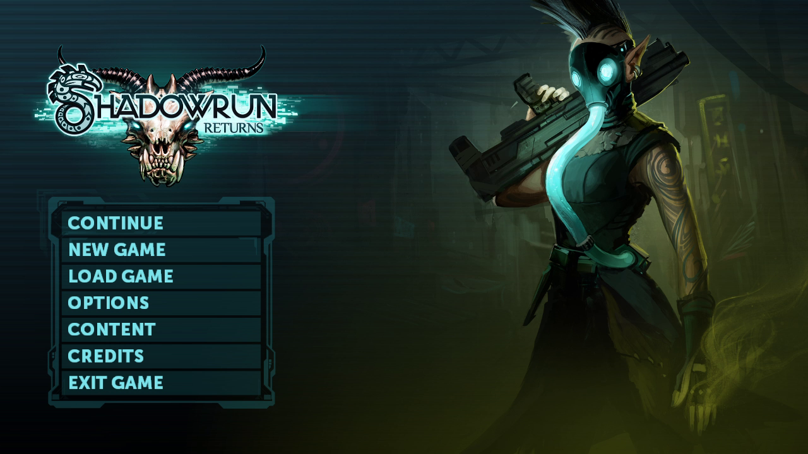
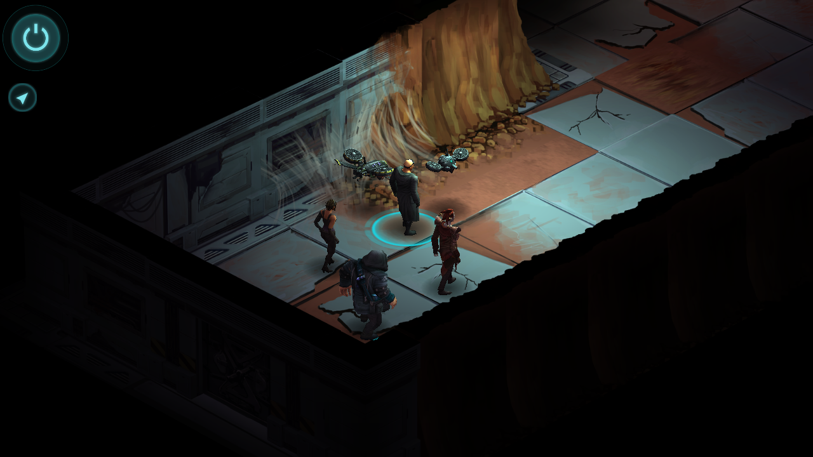

# Shadowrun Returns: static recompilation

Shadowrun Returns (Harebrained Schemes, 2013) recompiled with
[netrecomp](https://github.com/sp00nznet/netrecomp): all of the game's C# (and the
Unity engine's managed side and the class library) is compiled ahead of time to native
code, and Unity's player runs it through a drop-in `mono.dll` instead of mono's JIT.
Both the **Steam** and **GOG** releases (1.2.7) are supported.

This repo carries the setup and the per-title notes; the compiler and runtime live in
netrecomp, which follows the house style of [pcrecomp](https://github.com/sp00nznet/pcrecomp).

**Generated source is not distributed, and neither is any game data.** You supply your own
copy of the game; the recompiler runs on your machine and writes into gitignored folders.

## Status

**v0.1.0-dev, pre-alpha. In game: loads a save and plays (Steam build, Continue tested).**

| Step | Steam 1.2.7 | GOG 1.2.7 |
|---|---|---|
| Version detection (Assembly-CSharp.dll SHA-256) | yes | yes |
| Managed code lifted to C | 88867/88868 methods | 88867/88868 methods |
| Generated C compiles | yes | yes |
| `mono.dll` links and Unity's player loads it | yes | builds; not run yet |
| Main menu, headless (`-batchmode -nographics`) | yes: the log ends on the same `t=appview; cd=Main Menu` line as the original | not run yet |
| Main menu, windowed | yes: renders like the original (screenshot below) | not run yet |
| In game | yes: Continue loads the autosave, the party spawns with AI, click-to-move works; New Game and combat not tested yet | not run yet |

The one method that doesn't lift is `WinFuncs.GetTouchPoint`, a P/Invoke for Windows touch
input that takes a struct with a `bool` by value.

Known gaps on the way to the menu (the game carries on past each): sockets have no
internal calls yet (a `UdpClient` in a coroutine throws), and Steamworks rejects two cloud
callback structs because `Marshal.SizeOf` ignores `[MarshalAs]` layouts.

## Screenshots

Steam 1.2.7, 1280x720 windowed, recompiled `mono.dll`.



In game, Dead Man's Switch, loaded from an autosave:



## Getting Started

You need your own copy of Shadowrun Returns: Steam, or GOG (installed, or the offline
installer `setup_shadowrun_returns_1.2.7_(a)_(10017).exe` with its `-1.bin`).

### Quick start

1. Download this repo (Code > Download ZIP) and unzip it anywhere.
2. Double-click **`Setup.cmd`**. It checks for Python, the .NET 8 SDK, the Visual Studio
   C++ build tools, LLVM and Git, and asks before installing any of them (with sizes). It
   then finds the game (Steam library, GOG install, or a GOG installer next to the repo or
   in Downloads), copies it into `game\<version>\`, recompiles it and installs the result
   into that copy. Your own install is never changed.
3. Run **`Play Shadowrun Returns (steam-1.2.7).cmd`** (or the gog one). The Steam copy
   needs the Steam client running.

A failed run stops with one sentence saying what to do, and writes details to `setup.log`.
Running it again skips what's done.

### Step by step

The same steps by hand. Prerequisites: Python 3.10+, .NET 8 SDK, Visual Studio 2022 with
"Desktop development with C++", LLVM 18+ (`C:\Program Files\LLVM`), Git; innoextract for a
GOG installer.

1. Get netrecomp next to this repo:
   ```
   git clone https://github.com/sp00nznet/netrecomp ..\netrecomp
   ```
2. Copy the game somewhere writable, e.g. `game\steam-1.2.7\`, or unpack the GOG installer:
   ```
   innoextract -s -d game\_gog_installer setup_shadowrun_returns_1.2.7_(a)_(10017).exe
   ```
3. Recompile the managed code:
   ```
   dotnet build -c Release ..\netrecomp\tools\netrecomp
   dotnet ..\netrecomp\tools\netrecomp\bin\Release\net8.0\netrecomp.dll lift game\steam-1.2.7\Shadowrun_Data\Managed -o work\steam-1.2.7\gen
   ```
   Expected: `lifted 88867/88868 methods (4413 icalls, 450/451 pinvokes) in 8.5s -> work\steam-1.2.7\gen`
4. Compile `mono.dll` (10-20 minutes on a desktop; it is ~120 MB of C):
   ```
   py -3 ..\netrecomp\tools\build.py --gen work\steam-1.2.7\gen --out work\steam-1.2.7\mono.dll
   ```
5. Replace `game\steam-1.2.7\Shadowrun_Data\Mono\mono.dll` with it (keep the original).

Usual trip-ups: `python` opening the Microsoft Store means the Store alias is on, so use
`py`. A new PATH needs a new terminal window. In Git Bash, pass `--opt=-O1`, not `/O1`.

## Usage

```
Shadowrun.exe                                   normal run (from game\<version>\)
Shadowrun.exe -batchmode -nographics -logFile out.txt    headless: scripts run, no window
set NR_DEBUG=1                                  print every managed throw and fault with a native stack
set NR_INPUT=input.txt                          play from a command file (click X Y, key VK, ...), real mouse untouched
```

## Building from source

`tools/setup.py` is the build: it drives netrecomp's translator and `build.py`
(clang-cl, x86). Steam and GOG are separate builds because their three game assemblies
differ; the player, mono and corlib are identical. `tools/versions.json` maps
`Assembly-CSharp.dll` hashes to versions, and the built `mono.dll` checks the hash of each
assembly Unity loads against the one it was compiled from.

## License

MIT, see [LICENSE](LICENSE). Shadowrun Returns is (c) Harebrained Holdings; nothing from
it is in this repo.
